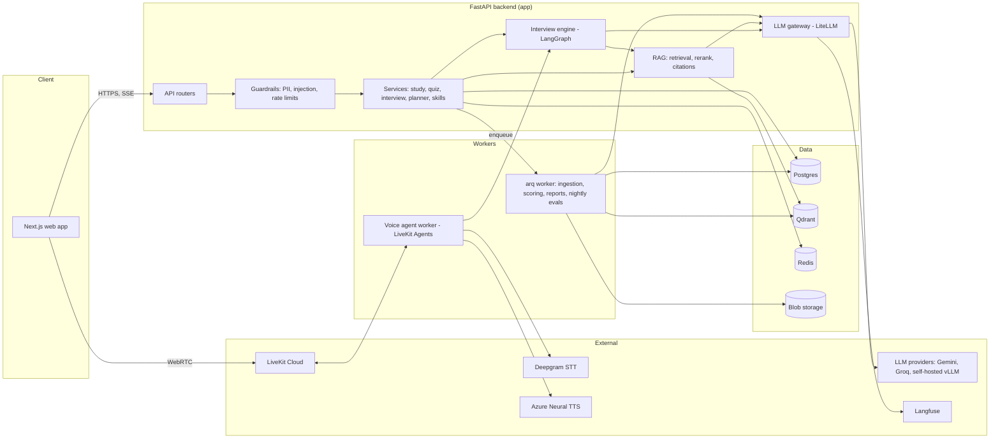
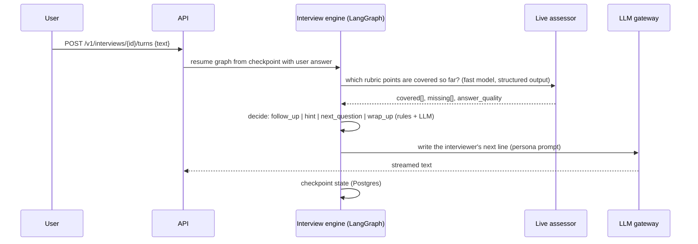
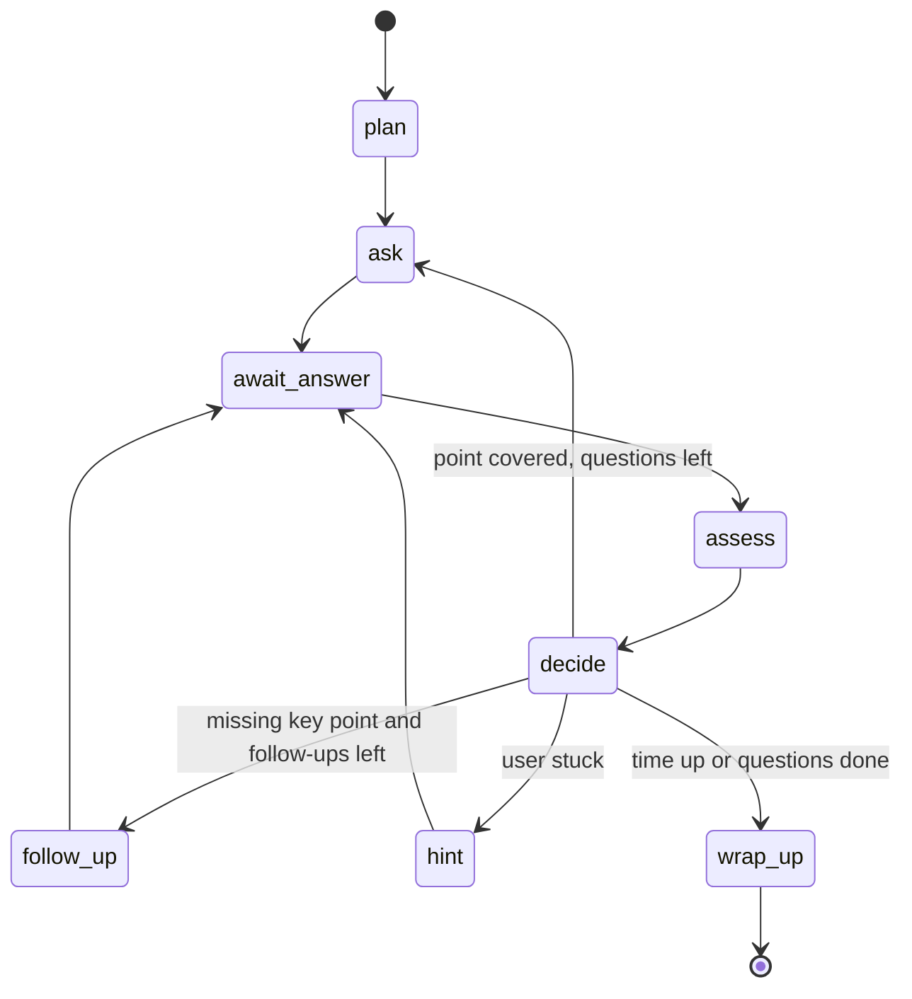
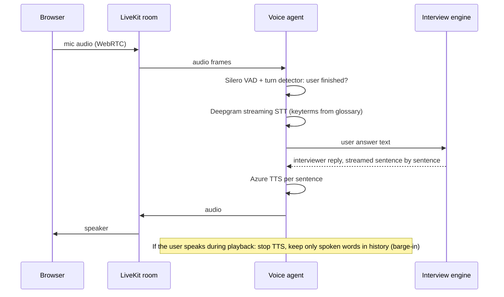

# 02 — Architecture

## 1. Big picture

AI Prep Buddy is a modular monolith: one FastAPI backend with clear internal modules, one background worker, and one voice worker. All three share the same code (`backend/app`). This is deliberate: a monolith is faster to build and debug, and clean module boundaries mean any module (for example the voice worker or the scoring worker) can become its own service later. Be ready to defend this in interviews ("why not microservices?").



## 2. Components

| Component | Responsibility | Key tech |
|---|---|---|
| API routers | HTTP endpoints, auth, request validation, SSE streaming | FastAPI, Pydantic |
| Guardrails | PII masking, prompt-injection checks on uploads and retrieved text, rate limits, quotas | Presidio, a small classifier, Redis token bucket |
| Study service | Orchestrates RAG answers, conversation memory, "make quiz cards" | LlamaIndex, Qdrant |
| Quiz service | Builds daily drills, grades answers, updates skill map | FSRS, judge |
| Interview service | Creates sessions, runs the interview engine for chat, exposes reports | LangGraph |
| Interview engine | Transport-agnostic state machine used by both chat and voice | LangGraph + Postgres checkpointer |
| Planner service | Resume and job-post parsing, gap analysis, plans, readiness | Structured outputs, skill map |
| Skills service | Mastery estimates per topic, scheduling | Elo-style update + FSRS |
| RAG module | Ingestion, chunking, hybrid retrieval, reranking, citation building | LlamaIndex, fastembed, Qdrant |
| LLM gateway | One entry point for all LLM calls: model routing, timeouts, retries, fallbacks, budgets, cost and latency logging, tracing | LiteLLM, Langfuse |
| Runtime evaluators | Live assessor (rubric coverage during a turn) and final judge (post-session) | Gateway + rubric prompts, later the distilled scorer |
| arq worker | Ingestion, post-session scoring, report building, quiz generation, nightly evals | arq, Redis |
| Voice agent | Joins LiveKit rooms; VAD, turn detection, STT, TTS, barge-in; drives the interview engine | LiveKit Agents |
| Postgres | System of record: users, content, questions, sessions, turns, scores, skills, feedback, eval runs | SQLAlchemy, Alembic |
| Qdrant | Vectors for knowledge-base chunks and questions (dense + sparse) | Qdrant |
| Redis | Rate limits, quotas, job queue, short-lived caches, live voice state | Redis |
| Blob storage | Uploaded resumes, opt-in audio, eval reports | Azure Blob (local: filesystem) |

## 3. Request flows

### 3.1 Study assistant: ask a question

```mermaid
sequenceDiagram
  participant U as User
  participant API
  participant S as StudyService
  participant R as RAG
  participant G as LLM gateway
  U->>API: POST /v1/study/ask {conversation_id, question, style}
  API->>S: ask()
  S->>S: load last 6 turns, mask PII
  S->>G: rewrite follow-up into standalone query (fast model)
  S->>R: retrieve(query, filters)
  R->>R: hybrid search top 30 (dense + BM25, RRF fusion)
  R->>R: cross-encoder rerank to top 6
  R-->>S: chunks + scores
  alt top rerank score < abstain threshold
    S-->>API: "Not covered" + closest topics
  else covered
    S->>G: generate answer with numbered sources (style prompt)
    G-->>API: token stream (SSE)
    S->>S: verify every [n] citation maps to a retrieved chunk
  end
  S->>S: save turn, cost, latency; trace to Langfuse
```

**Budgets:** rewrite 300 ms, retrieval 150 ms, rerank 250 ms (CPU, 30 pairs), first token 800 ms → first token p95 under 1.5 s.

### 3.2 Quiz: daily drill

1. `GET /v1/quiz/today` asks the skills service for topics that are due (FSRS) or weakest (lowest mastery with low confidence).
2. The quiz service picks 8–12 approved questions from the bank across those topics, mixing types and difficulties, avoiding questions seen in the last 14 days.
3. `POST /v1/quiz/answer` grades: MCQ exactly; short answer by the judge against the question's rubric (fast model); flashcards by self-rating.
4. Each graded answer updates mastery (Elo-style, weighted by question difficulty) and the FSRS card for that question.

### 3.3 Interview (chat): one turn



### 3.4 Interview engine states



**State (persisted each turn):** session settings, plan (list of question IDs with rubrics), current question index, rubric coverage per question, follow-ups used, elapsed time, transcript pointer, persona.

**Decision rules (deterministic first, LLM second):** max 2 follow-ups per question; move on when ≥ 80% of required rubric points are covered; wrap up when elapsed ≥ planned length minus 2 minutes; a hint only after a "stuck" signal (very short answer, "I don't know", or long silence in voice).

### 3.5 After a session: scoring and report

1. `POST /v1/interviews/{id}/end` marks the session ended and enqueues `score_session`.
2. The worker splits the transcript per question, then calls the final judge per question with the rubric and anchor examples. The judge returns structured JSON: score 1–5 per dimension, an evidence quote copied from the transcript, and a short rationale.
3. Evidence quotes are verified to exist in the transcript; a score without valid evidence is re-asked once, then flagged.
4. The report builder writes the summary, weakest area and a model answer (grounded in the knowledge base).
5. Skills are updated, quiz cards for weak topics are scheduled, and 10% of sessions are sampled into the eval review queue.

Scoring is idempotent: re-running `score_session` for the same session and judge version replaces the previous scores rather than duplicating them.

### 3.6 Voice turn (M5)



The interview engine is the same code for chat and voice. Voice is only a different transport. This is one of the main design points to explain.

**Latency budget, end of user speech to first bot audio (p95 target 1.2 s):**

| Stage | Budget |
|---|---|
| Turn detection | 400 ms |
| Final STT transcript | 150 ms |
| Live assessment | 0 on the critical path (runs on partial transcripts while the user speaks) |
| LLM first sentence | 350 ms |
| TTS first chunk | 150 ms |
| Network | 100 ms |
| **Total** | **1,150 ms** |

If the LLM is slow, the agent plays a short acknowledgement ("Okay, let's dig into that") while the reply is generated.

### 3.7 Knowledge-base ingestion

1. `make ingest` (or an admin endpoint) enqueues `ingest_source` per file in `content/` and per configured URL.
2. Parse (markdown, PDF, HTML) → normalise → split by headings with size limits, keeping code blocks whole → attach metadata (source URL, licence, title, section path, topic IDs from the tagger).
3. Compute dense (bge-small) and sparse (BM25) vectors; upsert into Qdrant collection `kb_chunks` with payload; store document and chunk rows in Postgres.
4. Content hash per document: unchanged documents are skipped; changed documents replace their chunks atomically (write new, switch, delete old).

### 3.8 Prep planner

1. Resume PDF → text → PII masking → structured extraction (skills, projects with tech and impact) via a Pydantic schema.
2. Job post text → required topics and seniority via structured extraction mapped to the topic taxonomy.
3. Gap analysis = job topics × skill map → strong / weak / untested.
4. Plan generator turns gaps into a schedule of study topics, quizzes and mock rounds. Readiness score per round = weighted mastery of the topics that round tests.

## 4. Capacity: launch vs design target

| Measure | Launch | Design target (for interview discussion) |
|---|---|---|
| Daily active users | 20 | 100,000 |
| Study questions per day | 200 | 1,000,000 (≈ 12 QPS average, 60 peak) |
| Voice minutes per day | 400 | 2,000,000 |
| Peak concurrent voice sessions | 5 | ≈ 8,300 |
| LLM calls per second at peak | < 1 | ≈ 300 |
| Knowledge-base chunks | 20,000 | 2,000,000 (384-dim float32 ≈ 3 GB; int8 ≈ 0.8 GB) |
| Transcript text per day | < 1 MB | ≈ 1.8 GB |

## 5. Key design decisions

Each becomes an ADR in `docs/adr/` when implemented.

| # | Decision | Chosen | Rejected | Why |
|---|---|---|---|---|
| 1 | Service shape | Modular monolith + workers | Microservices | Faster to build; boundaries kept so parts can split later |
| 2 | RAG framework | LlamaIndex for ingestion and retrieval plumbing; own reranking, citation and abstain logic | Everything hand-written / everything framework | Learn the framework the market uses while owning the parts interviewers probe |
| 3 | Retrieval | Hybrid dense + BM25 with reciprocal rank fusion, then cross-encoder rerank | Dense only | Technical terms (`QLoRA`, `HNSW`) are matched better by BM25; reranker fixes ordering |
| 4 | Vector DB | Qdrant | pgvector, Pinecone, Chroma | Native hybrid search and payload filters; open source; free cloud tier |
| 5 | Interview logic | LangGraph state machine with deterministic rules + LLM for wording | One big prompt | Testable transitions, explicit time and rubric tracking |
| 6 | Agent memory | Postgres checkpointer | In-memory | Survives restarts and reconnects |
| 7 | Scoring | Live fast assessor for steering; final judge after the session | Full scoring every turn | Accuracy without adding latency |
| 8 | Judge output | Structured JSON with per-dimension scores and verified evidence quotes | Free-text feedback | Checkable, comparable over time, evaluable |
| 9 | Skill model | Elo-style mastery per topic + FSRS per question | Average of scores | Accounts for difficulty and forgetting |
| 10 | Voice architecture | Cascaded STT → LLM → TTS | Speech-to-speech models | Need transcripts for scoring; each stage measurable and swappable |
| 11 | Voice transport | LiveKit (WebRTC) | Raw WebSockets | Jitter, echo cancellation, packet loss handled; agent framework included |
| 12 | LLM access | Own gateway on LiteLLM | Provider SDKs in services | Fallbacks, budgets, cost and traces in one place |
| 13 | Background jobs | arq on Redis | Celery, Kafka | Async-native, small; Service Bus / SQS named as scale path |
| 14 | Prompts | Versioned files + Langfuse prompt registry | Strings in code | Reviewable diffs, rollbacks, eval per version |

## 6. Failure modes and handling

| Failure | Handling |
|---|---|
| LLM provider timeout or 429 | Gateway: timeout per call class, 2 retries with jitter, fallback model chain, circuit breaker per provider |
| All LLM providers down | Study: return retrieved passages without generation. Interview: pause session with a message, keep state |
| Question not covered by the knowledge base | Abstain below rerank threshold; log as a content gap |
| Hallucinated citation | Citation verifier strips or regenerates; metric `citation_invalid_rate` |
| Prompt injection inside a resume, job post or document | Treated as data in a delimited block; injection classifier; tools are read-only; the judge never sees uploaded text as instructions |
| User asks the interviewer for the answer | Persona rule refuses during the round; model answer appears in the report |
| Duplicate submission or retry of a turn | Idempotency key on `POST /turns`; same key returns the stored result |
| Worker crash mid-scoring | Job retried; scoring is idempotent by (session, judge_version) |
| Voice: user pauses to think | Turn detector + longer silence allowance in interview mode |
| Voice: user talks over the bot | Barge-in stops playback, history keeps only spoken words |
| Voice: jargon misheard | Deepgram keyterms from the glossary; judge told transcripts may contain recognition errors |
| Cost spike from long sessions or abuse | Per-user daily token and voice-minute quotas; per-IP rate limits; budget alerts |
| Judge drift after a model change | Calibration set must pass before a judge version is activated |
| Personal data leak into logs | PII masking before logging and tracing; tests assert masked output |

## 7. Security and privacy

- Auth: GitHub OAuth login (M7); JWT session cookie; dev mode uses a fixed local user.
- Every query is scoped by `user_id` from the session, never from the request body.
- Uploaded files: size limit 5 MB, PDF/TXT only, parsed in the worker, stored in private blob storage.
- Audio: off by default; when enabled, retained 7 days; delete endpoint removes audio, transcript and scores.
- Secrets: Azure Key Vault in production, `.env` locally.

## 8. Observability

- **Traces:** Langfuse trace per request or turn, with spans for rewrite, retrieval, rerank, generation, assessor, TTS/STT; each span has latency, model, tokens and cost.
- **Metrics (Prometheus `/metrics`):** request latency histograms per route, LLM latency and errors per model, retrieval latency, queue depth, voice stage latencies, false-interruption counter, cost per user per day.
- **Logs:** structlog JSON with request and session IDs, no raw user text.
- **Quality scores in production:** Langfuse scores for sampled judge results, user feedback ("fair", "good follow-up"), abstain rate, citation-invalid rate.
- **Dashboards and alerts:** see `07_DEPLOYMENT_AND_OPS.md`.

## 9. Scaling path (for interview discussion)

1. Stateless API scales horizontally behind the container platform; workers scale on queue depth.
2. Voice workers scale on concurrent rooms; each worker handles N rooms (CPU-bound VAD + turn detection), measured in load tests.
3. Move judge and live assessor to the distilled small model on vLLM to cut cost and latency.
4. Semantic cache for study answers (same question, same knowledge-base version).
5. Postgres read replica for reports and analytics; partition `turns` by month.
6. Qdrant: int8 quantisation, then sharding by collection when chunks exceed memory.
7. Split services along existing module boundaries only when a team or scaling need appears.
